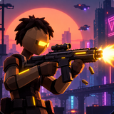
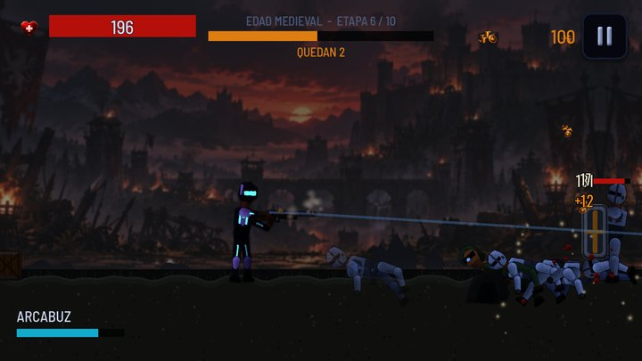
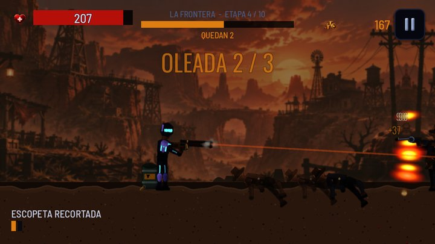
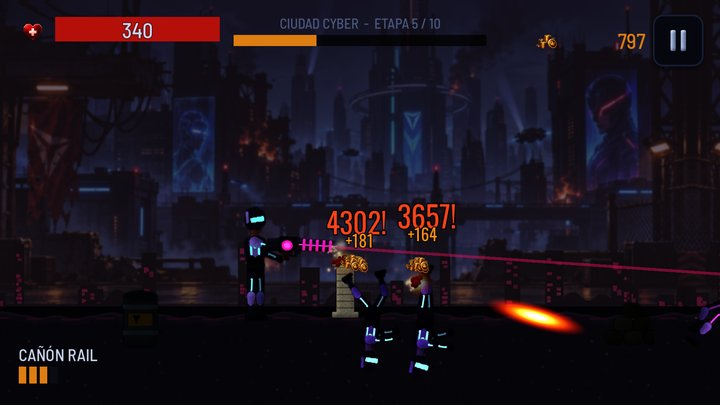
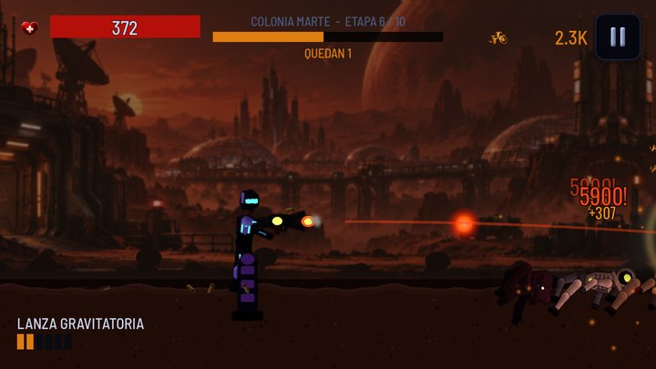

<h1 align="center">Era Breaker — side-scrolling roguelite shooter</h1>

  <b>Closed testing on Google Play — not public yet</b> ·
  Android · Godot 4.7 · GDScript · Python content pipeline

> **Portfolio excerpt — not the full source.** This repository contains a handful of files from a private
> codebase so reviewers can see how I write code. The game logic, the balance data, the art,
> saves, monetisation and the build configuration are intentionally left out. All rights reserved (see [LICENSE](LICENSE)).

  
  

  
  

Google Play listing images (Spanish UI, first art direction)

## What it is

A landscape, side-view **action roguelite shooter**. You fight your way through **10 historical eras and
100 stages**, from the Primal Age to the end of time, with 30+ weapons plus ammunition types and weapon
receivers that change how each gun handles. Die, keep your coins, upgrade, and go again.

Characters and creatures are not frame animations: they are **procedural rigs** with inverse kinematics,
foot placement on real terrain, and articulated **ragdolls** on death, so every hit and every fall is different.

## Status

| | |
|---|---|
| Google Play | **Closed testing — not public yet** |
| Started | September 9–10, 2026 |
| First playable build | The same day: the first commit (September 10, 2026) is a complete, playable game |
| On Google Play | Version 1.0.3 accepted on the closed testing track on October 9, 2026 |
| Current version | 1.0.4, still in active development (new characters, art and gameplay passes in October 2026) |

## Scale of the codebase

- **~22,500 lines of GDScript** in the game itself (gameplay, rigs, UI, data classes)
- **~26,000 more lines of GDScript** in headless QA, review and art-baking tools, and **~7,800 lines of Python**
  (25 scripts) that generate content and balance data
- 100 precomputed stage plans and balance resources exported from a single Python source of truth

## Tech stack

**Game:** Godot 4.7, GDScript, 2D physics (`RigidBody2D`, `PinJoint2D`), canvas-item shaders, Android export (AAB)
for arm64, armv7 and x86_64.

**Content pipeline:** Python (NumPy, Pillow) and ffmpeg. All sound effects and the music are **synthesised from
code**, with no samples. The first version's sprites, backgrounds, particles, UI and store graphics were generated
the same way; later art passes added painted backdrops and redesigned characters baked inside Godot.

## Engineering highlights

- **Ragdolls that fall like bodies.** [`ragdoll.gd`](scripts/gameplay/ragdoll.gd) turns a live rig into up to 11
  rigid bodies joined by pins, with custom relative joint limits, a private collision layer per corpse so the
  limbs collide with their own torso and legs (but never with players or other corpses), and a budget on how
  many physics bodies can be active at once.
- **Walking with real feet.** [`biped_gait.gd`](scripts/gameplay/biped_gait.gd) plants each foot on the actual
  ground (ray casts, slopes, crates), predicts landings ahead of an accelerating body, handles turning without
  sliding the feet, and rolls the sole from heel to toe. [`quadruped_motion.gd`](scripts/gameplay/quadruped_motion.gd)
  is the physical locomotion layer for four-legged enemies: acceleration, braking, committed leaps and landings.
- **Adaptive music.** [`audio_manager.gd`](scripts/core/audio_manager.gd) plays three phase-locked stems per era
  (ambient, combat, boss) and crossfades them with the intensity of the fight, plus a pooled SFX voice system.
- **Allocation-free combat.** [`pool_manager.gd`](scripts/core/pool_manager.gd) pools bullets, casings, impacts
  and damage numbers, with per-scene idle caps and protection against releasing the same node twice.
- **Variety from one sprite.** [`enemy_wardrobe.gdshader`](assets/shaders/enemy_wardrobe.gdshader) re-dyes clothing
  and hair through a mask while keeping the painted shading, and adds stripes, checks or spots.
- **Sound from maths.** [`gen_audio.py`](tools/gen_audio.py) synthesises gunshots, impacts, UI sounds and a
  three-layer score for each era with oscillators, envelopes, filters and a simple reverb.

## What's in this excerpt

| File | What it shows |
|---|---|
| `scripts/gameplay/ragdoll.gd` | Articulated ragdoll with joint limits and self-contact |
| `scripts/gameplay/biped_gait.gd` | Procedural two-legged gait with ground contacts and foot roll |
| `scripts/gameplay/quadruped_motion.gd` | Physics locomotion for four-legged creatures |
| `scripts/core/audio_manager.gd` | Pooled SFX and three-stem adaptive music |
| `scripts/core/pool_manager.gd` | Generic scene pooling for mobile performance |
| `assets/shaders/enemy_wardrobe.gdshader` | Mask-based clothing re-dye shader |
| `tools/gen_audio.py` | Procedural sound and music synthesis (NumPy) |

Code comments are mostly in English, some in Spanish.

**Not included on purpose:** the rigs and their IK, the enemy AI and stage director, weapons and balance data,
the save system, ads and in-app purchases, the art generators, the project file and export presets, and
credentials. The excerpt can't be built or run.

---

Built by **Cristian Luis Celie**: [GitHub profile and CV](https://github.com/keblardo) · cristiancelie07@gmail.com
